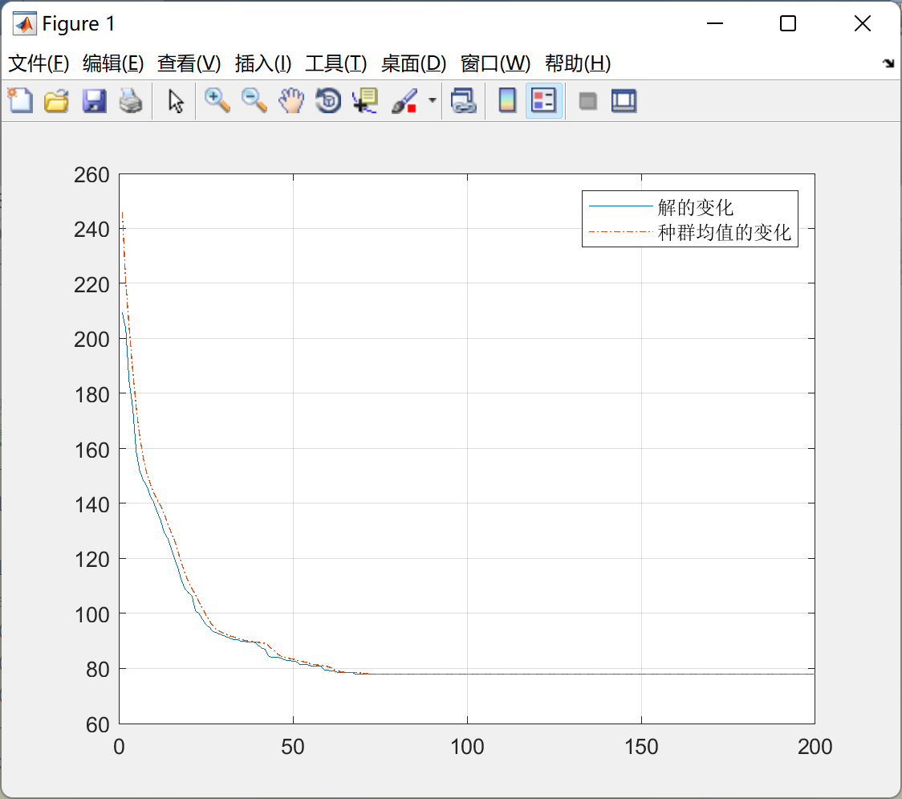
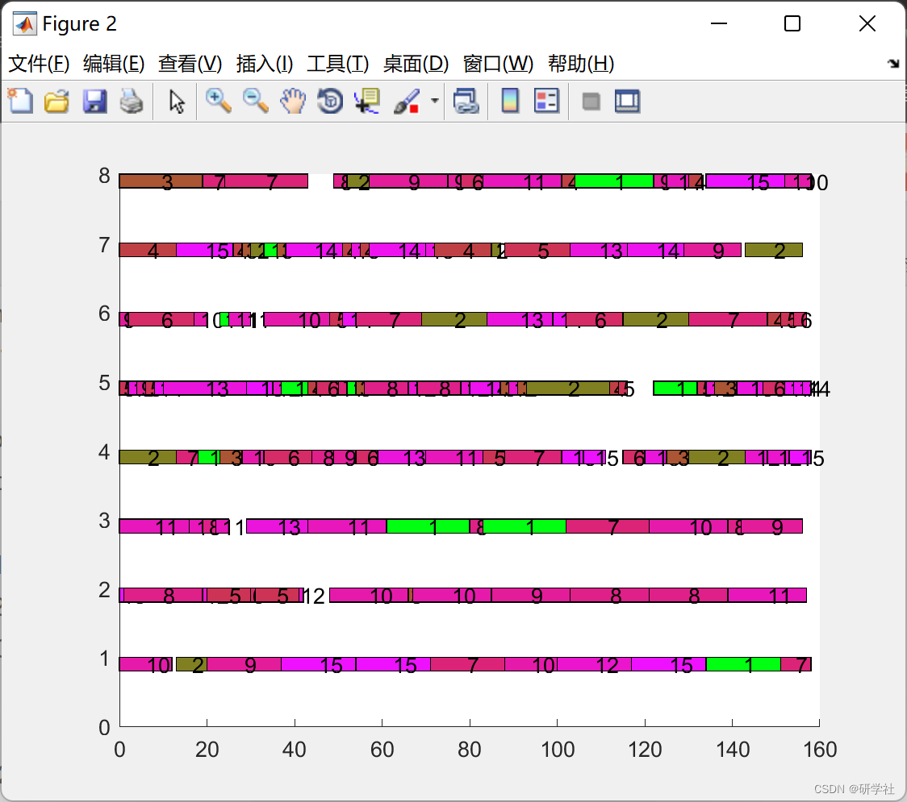
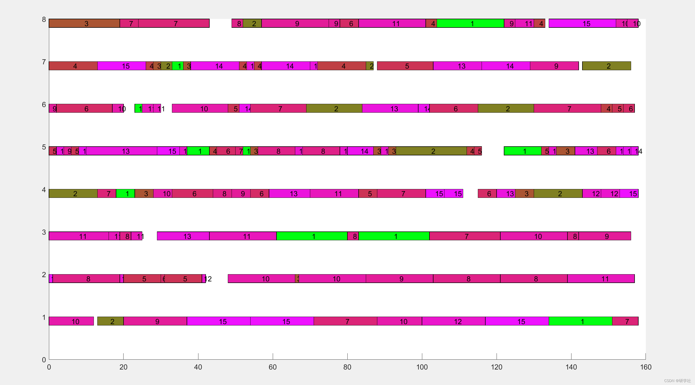

# Research on flexible workshop scheduling optimization based on migratory bird optimization algorithm (MBO) (Matlab code implementation)

​  
💥💥💞💞 Welcome to this blog❤️❤️💥💥 🏆 Bloggers' Advantages: 🌞🌞🌞 The content of the blog strives for rigorous thinking and clear logic, making it convenient for readers. ⛳️ Mantra: "Those who travel a hundred miles in a single stretch may find that half of the journey is made in the last ninety minutes." 1 Overview In the FJSP-LS solution method, existing research primarily employs metaheuristic algorithms such as genetic algorithms, differential algorithms, taboo search [1,8], and particle swarm optimization [9]. Most focus on optimizing dispatch schemes, with less in-depth research into the formulation of batch partitioning schemes.The Migrating Bird Optimization (MBO) algorithm, first proposed by DUMAN in 2011, is a natural heuristic metaheuristic algorithm. It is characterized by its simplicity, ease of understanding, and minimal parameters, making it highly effective for various optimization problems. Particularly in solving quadratic assignment problems, the MBO has yielded solutions superior to those obtained by simulated annealing algorithms, tabu search algorithms, and guided evolutionary simulated annealing algorithms. Moreover, an increasing number of scholars are exploring the application of MBO in production line scheduling, achieving high-quality solutions. This paper focuses on the flexible workshop scheduling optimization research based on the Migrating Bird Optimization (MBO) algorithm.
📝2 Running Results\n        \n  
No output.
Editor
Editor
%% Touring phase
for i=1:G  
%% LEADINGBIRD EVOLUTION
[leader,Z_leader,share,Z_share]=bird_evolution(leader,Z_leader,[],[],...  
N_size,S_size,total_op_num,num_machine,e,num_job,num_op);  
%% Evolve with birds
% Initialize the shared solution for left and right queues
share_left=share;  
Z_share_left=Z_share;  
share_right=share;  
Z_share_right=Z_share;  
for j=1:sp  
% Left queue
[lefts(j,:),Z_left(j),share_left,Z_share_left]=bird_evolution(lefts(j,:),Z_left(j),share_left,Z_share_left,...  
N_size-S_size,S_size,total_op_num,num_machine,e,num_job,num_op);  
% Right queue
[rights(j,:),Z_right(j),share_right,Z_share_right]=bird_evolution(rights(j,:),Z_right(j),share_right,Z_share_right,...  
N_size-S_size,S_size,total_op_num,num_machine,e,num_job,num_op);  
end  
%% Competition Mechanism 2: Inter-Team Crossover
% Randomly generate G2 individuals with the same position.
ind=randperm(sp,G2);  
[rights(ind,:),Z_right(ind),lefts(ind,:),Z_left(ind)]= crossover(lefts(ind,:),rights(ind,:),...  
Z_left(ind),Z_right(ind),total_op_num,num_machine,e,num_job,num_op);  
end  
%% Competition Mechanism 1: Intra-Team Competition
ind=randperm(sp,G1);  
% Left queue
[~,ind1]=sort(Z_left(ind));  
lefts(ind,:)=lefts(ind(ind1),:);  
Z_left(ind)=Z_left(ind(ind1));  
% Right queue
[~,ind2]=sort(Z_right(ind));  
rights(ind,:)=rights(ind(ind2),:);  
Z_right(ind)=Z_right(ind(ind2));  
%% Replace with "Leading Bird"
if rand<0.5  
% Select the first bird in the left queue.
[leader,Z_leader,lefts,Z_left]=update_leader(leader,Z_leader,lefts,Z_left);  
else  
% Select the first bird in the right queue.
[leader,Z_leader,rights,Z_right]=update_leader(leader,Z_leader,rights,Z_right);  
end  
%% Record relevant data
% Record the optimal fitness and average fitness for each generation.
Z=[Z_leader,Z_left,Z_right];  
[val,ind]=min(Z);  
trace(1,gen)=val;  
trace(2,gen)=mean(Z);  
% Update the global optimal fitness
if gen==1 || MinVal>trace(1,gen)  
MinVal=trace(1,gen);  
end  
end  
%% ============================Output Result=============================
%% Output the optimal fitness
fprintf('Optimal fitness:'),disp(MinVal)
%% Plotting the iterative curve of optimal fitness and average fitness.
figure(1)  
plot(trace(1,:));  
hold on;  
plot(trace(2,:),'-.');grid;  
legend('Changes in Solution', 'Changes in the mean population');
% Draw the Gantt chart of the global optimal solution.
[Z,~,~,machine_time,Pvals]=fitness(leader,num_machine,e,num_job,num_op);  
Pval1=Pvals{1,1};  
figure(2);  
for i=1:total_op_num  
mText=leader(total_op_num+i);  
b=leader(i);  
x1=Pval1(1,i);  
x2=Pval1(2,i);  
y1=mText-0.2;  
y2=mText;  
hold on;  
fill([x1,x2,x2,x1],[y1,y1,y2,y2],[1-1/b,1/b,b/num_job]);  
text((x1+x2)/2,mText-0.1,num2str(b));  
end  
📃3 References [1] Liu Xuehong, Duan Cheng, Wang Lei. The flexible batch scheduling problem in a bird-flying algorithm-based flexible job shop [J]. Computer Integrated Manufacturing Systems, 2021, 27(11): 3185-3195. DOI: 10.13196/j.cims.2021.11.012.
[2] Ren Caile. Research on Hybrid Water-Flow Shop Scheduling Problem Based on Migratory Bird Optimization Algorithm [D]. Huazhong University of Science and Technology, 2019.
[3] Liu Xuehong, Duan Cheng, Wang Lei. Batch Scheduling Problem for Flexible Workshop Based on an Improved Migratory Bird Algorithm [J]. Computer Integrated Manufacturing Systems, 2021, 27(11): 3185-3195. DOI: 10.13196/j.cims.2021.11.012.
📋4 Matlab code implementation

## Images

<!-- PAYMENT_BLOCK -->

## Get this dataset

- Payment link (Stripe): [Buy now](https://buy.stripe.com/3cs8yP7sY87d0vu9AB)
- Payment QR code: 

<!-- /PAYMENT_BLOCK -->
